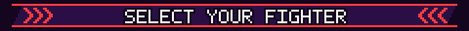
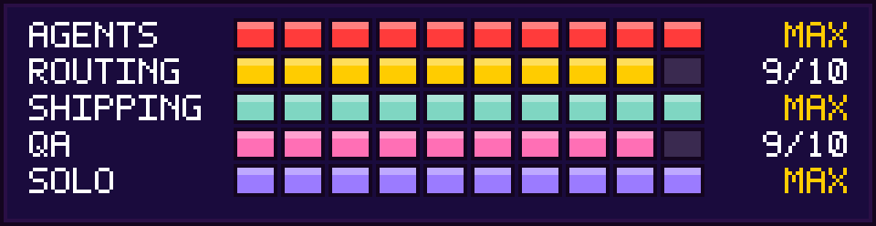
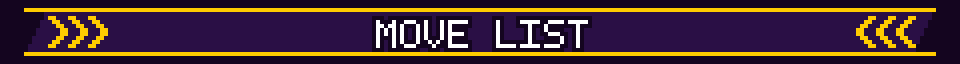
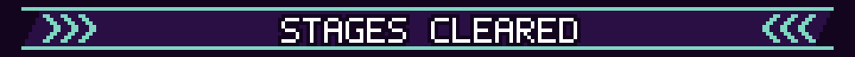
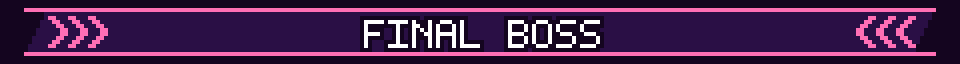

  

  <b>🕹️ P1: QUINTIN MONTGOMERY</b> · Solo founder of <b>LAMUH Development Services</b> (Tampa, FL) 
  I build multi-agent AI systems and ship production work for real clients. Solo, end to end.

  

  

  

| Input | Special Move | What it does |
| :---: | :--- | :--- |
| `↓ ↘ → + P` | **LAMUH Business Bot** | An 11-agent ops system with a model routing layer (semantic aliases instead of hardcoded model IDs) and a deliberate no-LLM fallback: no API key → deterministic rule-based output from raw data, hallucination impossible by design. *Being prepared for public release.* |
| `→ ↓ ↘ + K` | **LAMUH AIOS** | A shared memory layer that lets my coding agents (Claude Code + Codex) keep long-term context between sessions through a common Obsidian vault over MCP. Goal: agents that compound knowledge instead of starting cold. |
| `← ↙ ↓ ↘ → + P` | **[casita-blast](https://github.com/lamuh24/casita-blast)** | Interactive 3D home viewer: real-time sun simulation, live material swaps, Android AR. |
| `↓ ↓ + P K` | **[no-gods-above](https://github.com/lamuh24/no-gods-above)** | A fighting game built through agent orchestration with automated browser QA gates (real CDP keyboard input, pixel-measured jump clearance). |

  

  🏆 <a href="https://nugencasitas.com"><b>nugencasitas.com</b></a> &nbsp;·&nbsp;
  🏆 <a href="https://tpwgtampa.com"><b>tpwgtampa.com</b></a> &nbsp;·&nbsp;
  🏆 <a href="https://quickandprecise.com"><b>quickandprecise.com</b></a>

  

> **BOSS: MODEL ROUTING.** Different models are genuinely better at different tasks, so how do you measure that rigorously and build infrastructure that acts on it? Building an open-source eval harness in Python to find out.

  

<i>I don't just prompt AI. I orchestrate it, QA it, and design for the moments it fails.</i>

<!-- Pixel art is generated by scripts/build_pixel_ui.py -->
